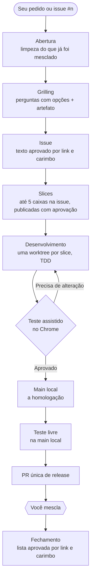
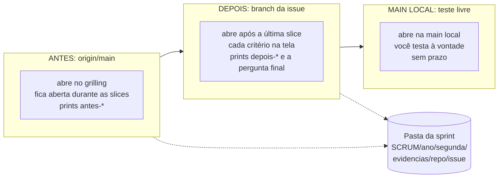

# Frontlights

Uma skill do Claude Code que leva um pedido seu, ou uma issue do GitHub, da conversa até uma PR pronta
para você mesclar: entrevista, issue aprovada, slices, implementação em worktrees, teste assistido no
Chrome e homologação na sua main local. Para quem já usa o Claude Code num repositório do GitHub e quer
decidir o produto sem perder o controle do que é escrito, mesclado ou fechado.

Situação: uso supervisionado no Windows (Python 3.11+, Git, GitHub CLI autenticado). O texto da skill e
os scripts estão sendo redesenhados (`docs/redesenho/`); o que você vê não muda.

## O fluxo, do pedido à release



O caminho se ajusta ao tamanho do pedido. Um ajuste óbvio vai **direto**, sem issue, mas com o teste
assistido e a main local. Um pedido médio passa pelo grilling e por um plano curto. Uma funcionalidade
nova percorre o fluxo inteiro.

## O que você vê

**Perguntas com opções.** Toda decisão chega como uma pergunta com duas a quatro opções concretas, a
recomendada primeiro. Você responde com um clique; texto livre ("não entendi") amplia a explicação.

**Aprovação por link e carimbo.** Documento, lista ou tabela nunca é aprovado colado na conversa. Ele vira
um arquivo em `.frontlights/`, com link clicável, e a pergunta cita a revisão e o carimbo:
"Aprova r2 · 6c29ce70c2c7?". Se o arquivo muda depois do seu "Sim", a aprovação não vale e a pergunta volta.
Descoberta, texto da issue e publicação no GitHub têm aprovações separadas (a regra está no
`SKILL.md`, "Show before approval").

**O artefato do grilling.** Uma página por entrevista, com o print da base primeiro e uma seção por
decisão, para você comparar as opções antes de escolher.

**A janela do Chrome.** Numa issue com tela, o Frontlights abre um Chrome visível, pelo Playwright, com
perfil descartável e uma faixa no topo que diz o que está na tela. Você assiste, a sessão grava os prints,
e no fim escolhe: **Assistir de novo**, **Aprovado**, **Precisa de alteração** ou **Pode prosseguir**. Esse
teste, um por issue, é o único portão até a main local; a release exige ainda a suíte inteira verde.



Os prints vão para a pasta da semana em `SCRUM/` (resolvida por `progress_report.py evidence-dir`), de
onde o resumo semanal escolhe os seus.

**A main local como homologação.** O trabalho aprovado entra na sua `main` local, nunca na remota. Ali
você faz o teste livre; um defeito volta como correção na branch da issue.

**A PR que você mescla.** Ao fim, uma única PR leva a ponta da main local para uma branch de release, com
`Closes #n` das issues prontas. O Frontlights acompanha a PR; quando ela está pronta, ele pergunta se pode
mesclá-la; só o seu "Sim" faz o merge.

## O que você controla e o que nunca acontece sem você

Na etapa 6 a skill trabalha sob uma autorização permanente: edita, testa, faz commit, mescla slices na
branch da issue, empurra a branch da issue e marca critérios com evidência, sem pergunta de abertura.

Cada operação negada só roda depois do "Sim" de uma pergunta própria, que cita o comando exato:

- mesclar uma PR (a de release incluída);
- fechar uma issue;
- mexer no quadro do projeto;
- escrever na `main` remota ou numa branch protegida;
- publicar ou ligar algo em produção;
- editar uma migration já registrada;
- apagar qualquer coisa, fora a limpeza do que já foi mesclado;
- trocar a conta do GitHub (`gh auth switch`).

Um "Sim" vale só para aquela operação. A regra completa vive em
[`references/development.md`](skills/frontlights/references/development.md#standing-authorization-and-the-denied-operations),
"Standing authorization and the denied operations".

Nenhum hook bloqueia nada: a skill não instala hook, e o que ela confere sai como aviso de script ou como
pergunta. As permissões do próprio Claude Code continuam valendo.

## Instalação e primeiro uso

A skill é a pasta `skills/frontlights` deste repositório. Instale por uma junção, sem cópia:

```powershell
git clone <url-deste-repositório> <pasta-do-clone>
cmd /c mklink /J "$HOME\.claude\skills\frontlights" "<pasta-do-clone>\skills\frontlights"
```

`~/.claude/skills/frontlights` passa a ser a própria pasta do clone: `git pull` atualiza a skill, e uma
sessão nova já lê a versão nova. Não há número de versão; a etapa 0 (`update-check`) avisa quando o clone
está atrás do remoto. Para desinstalar, `rmdir "$HOME\.claude\skills\frontlights"` apaga só o atalho.

No projeto de destino, a skill grava o primeiro `.frontlights/config.json` por `frontlights.py init-config` (o
`repository` vem do remoto; o quadro é perguntado) e deixa `.frontlights/` fora do Git. O mínimo é:

```json
{
  "repository": "OWNER/REPOSITORY",
  "branchPrefix": "PREFIX/",
  "project": null,
  "roads": null
}
```

Sem remoto, use `"repository": null`: as issues ficam em `.frontlights/issues/<n>/`. Os blocos opcionais
(teste no navegador, backup da homologação, resumo semanal) estão em
[`examples/config.json`](skills/frontlights/examples/config.json); sem `browserTest`, uma mudança de tela
vira uma pergunta, nunca um teste pulado.

Depois, numa sessão do Claude Code aberta no projeto:

```text
frontlights, ataque a issue 12
```

`/frontlights` também abre a skill. Um lembrete a cada prompt é opcional: o modelo
`skills/frontlights/templates/frontlights-prompt-hook.py` (evento `UserPromptSubmit`) só lembra, nunca
bloqueia, e você o liga no seu `settings.json` se quiser.

## As etapas

Os scripts ficam em `skills/frontlights/scripts/`; cada um tem `--help`.

| Etapa | O que acontece | Comando principal |
|---|---|---|
| 0. Atualização | compara o clone com o remoto | `frontlights.py update-check` |
| 1. Abertura | busca, limpa o que foi mesclado, escolhe o caminho | `frontlights.py open`, `cleanup.py run` |
| 2. Inspeção | acha o config (ou o cria), lê issue, quadro e família | `frontlights.py inspect --summary`, `init-config` |
| 3. Grilling | reconhecimento, perguntas, artefato, janela ANTES | `serve.py window open`, `frontlights.py artifact` |
| 4. Issue | corpo da issue aprovado por link e carimbo | `frontlights.py stamp` |
| 5. Slices | até cinco caixas, publicação aprovada | `frontlights.py validate-plan`, `publish-issue` |
| 6. Desenvolvimento | slices, teste assistido, main local, teste livre, release | `frontlights.py charter`, `slice`, `browser-gate`; `homolog.py merge`; `serve.py free-test`; `homolog.py release` |
| 7. Fechamento | lista carimbada; fechar tem aprovação própria | `closeout.py run`, `closeout.py apply` |

Para retomar uma issue parada, diga "retome a issue #12" (`frontlights.py resume`).

## Para quem desenvolve o Frontlights

`tests/`, `evals/` e a documentação da raiz ficam fora da skill.

```powershell
python tests/pre_commit.py
python -m unittest discover -s tests -v
python -m compileall -q skills/frontlights/scripts tests
```

- `python tests/pre_commit.py`, antes de cada commit: em segundos, o `compileall` e os testes que a mudança
  toca; o que não cabe no prazo fica para a suíte inteira. Ele só relata, nenhum hook o roda.
- `python -m unittest discover -s tests -v` é a suíte inteira, à mão; `python tests/suite.py` roda a
  rápida em paralelo.
- `python skills/frontlights/scripts/skill_lint.py --shingles --min-words 15` lista os trechos repetidos entre os
  textos da skill; só relata (o `pre_commit.py` o mostra quando um texto da skill muda).
- O roteiro e as regras de toda etapa: [`skills/frontlights/SKILL.md`](skills/frontlights/SKILL.md).
- As regras da etapa 6: [`references/development.md`](skills/frontlights/references/development.md).
- Os formatos dos registros e a retomada: [`docs/protocol.md`](skills/frontlights/docs/protocol.md).
- Os limites das permissões: [`docs/security.md`](skills/frontlights/docs/security.md).
- O contrato com o RoadS, a integração opcional do resumo semanal: [`docs/roads-contract.md`](skills/frontlights/docs/roads-contract.md).
- O redesenho em andamento, com a proposta e o roteiro de issues: [`docs/redesenho/`](docs/redesenho/).
